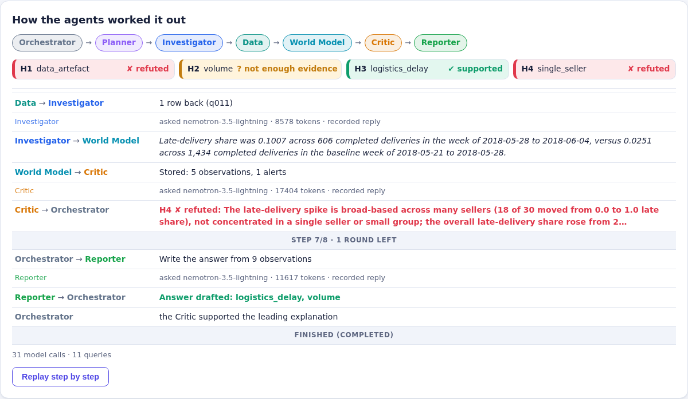
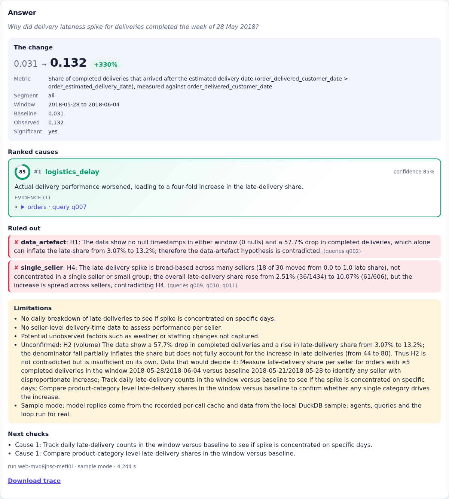
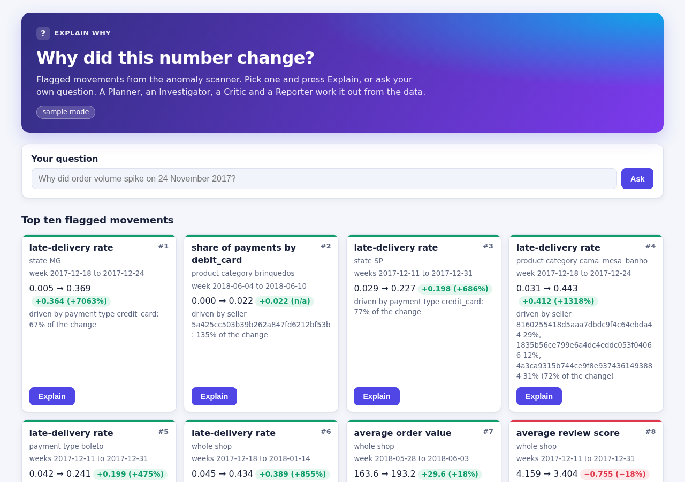
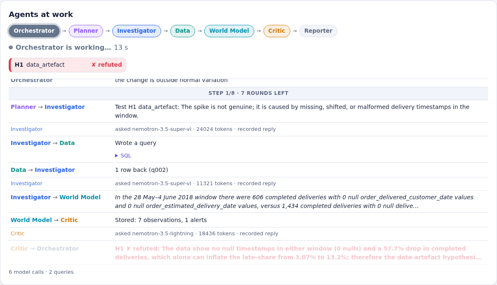
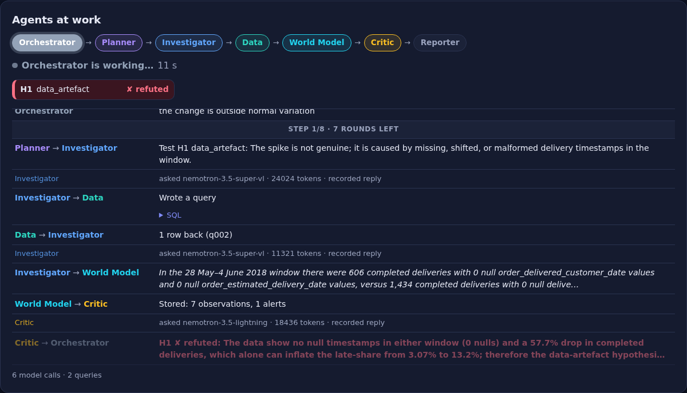
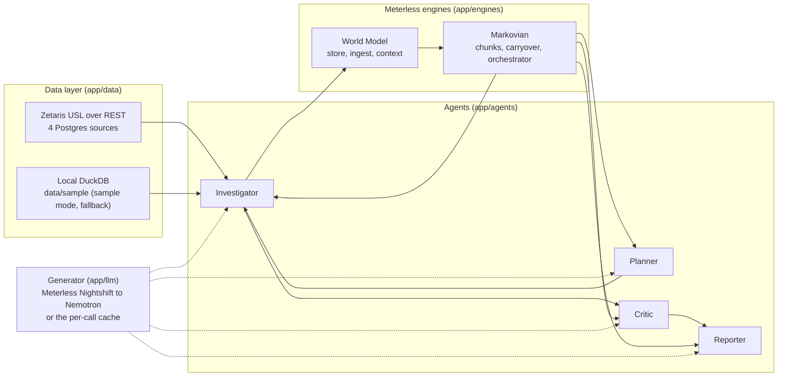

# explain-why-agent

## Summary

explain-why-agent asks why a business number changed, investigates across four data sources, tries
to disprove its own explanation, and answers with evidence or says it cannot be determined. You ask
a question such as "Why did order volume spike on 24 November 2017?" (or pick a flagged anomaly on
the web board). A Planner turns it into a metric, window, baseline and hypotheses. An Investigator
tests each hypothesis with read-only SQL through the Zetaris Unified Semantic Layer. A Critic tries
to break every explanation. A Reporter returns ranked causes, each with the query and the numbers
behind it, the explanations it ruled out, and the limits of the answer. The investigation runs on
two Meterless engines (World Model and Markovian) inside this repository, and every model call goes
through Meterless Nightshift to NVIDIA Nemotron. Every step is written to a JSONL trace.
Hackathon track: **Track 02, "The Agent That Can Explain Why"**.

| The agents at work (replay of a recorded Nemotron run) | The answer |
|---|---|
|  |  |

## Quick start (sample mode)

Sample mode needs no credentials and no network apart from `pip install`. It uses the local DuckDB
copy of the data in `data/sample/` and model replies recorded per call in `data/sample/llm_cache/`.
The agents, queries and loop all run; only each model reply comes from the cache (see
[AI and model usage](#ai-and-model-usage)). You need Python 3.11 or newer. From a clean clone:

```bash readme-quickstart
python3 -m venv .venv
. .venv/bin/activate
pip install -r requirements.txt
SAMPLE_MODE=true python run.py "Why did order volume spike on 24 November 2017?" --run-id quickstart
ls -l logs/result-quickstart.json logs/trace-quickstart.jsonl logs/queries-quickstart.jsonl
```

- The result JSON is printed on stdout and saved as `logs/result-quickstart.json`. It holds the
  change, the ranked causes with evidence, what was ruled out, the limitations and `"sample_mode": true`.
  With the committed cache the answer is `volume` (a broad rise across sellers), with `single_seller`
  and `data_artefact` ruled out.
- The trace is `logs/trace-quickstart.jsonl`, one line per agent action and per model call. Each
  model-call line shows the provider (`cache`), the route requested, the model that produced the
  recorded reply (`model_routed`), how it was recorded (`recorded_with`) and the receipt id.
- **These replies are not a model's.** Since Sprint 11c the replies this question replays were
  recorded from the deterministic stand-in in `app/llm/stub.py`: every model-call line reads
  `recorded_with: stub`, `model_routed: scripted-stub`, `receipt_id: null`. So the run shows the
  agents, the Markovian loop, the queries and the trace working end to end, not Nemotron's reasoning.
  To replay Nemotron's replies, recorded through Nightshift on 25 Oct, add
  `LLM_CACHE_DIR=data/recorded/nemotron/llm_cache` to the command.
- The query log is `logs/queries-quickstart.jsonl`: every SQL statement with its source, adapter,
  duration and row count.
- The command uses the default Markovian loop with the Critic. The same question also replays on the
  Sprint 2 simple loop (`--loop simple`, stub-recorded as well). [Usage](#usage) lists the other
  questions that have recordings.
- On Apple Silicon, if you see `incompatible architecture (have arm64, need x86_64)`, your shell
  runs under Rosetta: run the commands from a native terminal or prefix them with `arch -arm64`.
- CI runs exactly this block from a fresh checkout with an empty `.env` (job `readme-quickstart`,
  "Plan check O", script `scripts/readme_quickstart.py`).

## Docker

The `Dockerfile` (python:3.11-slim, CPU only) installs everything at build time; the container
starts the API with `python -m app.api` on 0.0.0.0:8000 and installs or downloads nothing.

```bash
docker build -t explain-why-agent .
docker run --rm -p 8000:8000 -e SAMPLE_MODE=true explain-why-agent
```

In a second terminal, from the repository root:

```bash
curl -s -X POST http://localhost:8000/run -H "Content-Type: application/json" -d @input_examples/example_1.json
```

It returns the result JSON (`"status": "success"`, `"sample_mode": true`, rank-1 cause `volume`);
the web page is at http://localhost:8000/. CI builds and runs the image on every push (job
`docker-check`, "Plan check P": the three example inputs, HTTP 200 and a schema-valid result each,
and example 1 again with `--network none`). For full mode pass the settings at run time with
`--env-file .env`; Nightshift and Zetaris run outside the container, so use the `host.docker.internal`
variants of `METERLESS_BASE_URL` and `ZETARIS_URL` given in `.env.example` (on Linux add
`--add-host=host.docker.internal:host-gateway`). No secret is baked into the image.

## Full mode

A live run (`SAMPLE_MODE=false`) calls the real services:

1. **Meterless Nightshift running locally (the primary provider).** The app talks to the Meterless
   Runtime over its OpenAI-compatible API. Set `METERLESS_BASE_URL` (the Runtime URL; the default in
   `.env.example` is the local runtime on `127.0.0.1:8088/v1`) and `METERLESS_RUNTIME_TOKEN` (the
   Runtime's token). `METERLESS_MODEL` and `METERLESS_MODEL_PLANNER` / `_INVESTIGATOR` / `_CRITIC` /
   `_REPORTER` choose the routing mode; when empty, the Planner and Reporter use `meterless/deep` and
   the Investigator and Critic `meterless/fast`.
2. **NVIDIA.** The NVIDIA key lives in Nightshift's Providers tab, not in this project. Nightshift
   routes every `meterless/*` call to a Nemotron model. A direct NVIDIA fallback exists for when
   Nightshift is unreachable (`NVIDIA_API_KEY`, `NVIDIA_BASE_URL`, `NVIDIA_MODEL`; leave them empty
   to disable it), and `MODEL_PROVIDER=nvidia` uses NVIDIA directly with no Meterless.
3. **A Zetaris instance with the four sources and the USL.** Four Postgres databases (one per
   source system) registered in Zetaris, and the Unified Semantic Layer `olist_usl` over them. The
   setup is scripted and idempotent: `python scripts/zetaris_setup.py` (add `--dry-run` to only
   print the statements). `docker-compose.zetaris-sources.yml` describes the four Postgres sources.
   Set `ZETARIS_URL`, `ZETARIS_ORG_ID` and `ZETARIS_API_KEY` (or `ZETARIS_USERNAME` /
   `ZETARIS_PASSWORD` for the login fallback); `OLIST_PG_PASSWORD` is read only by the setup script.
   `DATA_LAYER=zetaris` is the default; with `ZETARIS_URL` empty the app uses the local DuckDB data
   and says so.

Copy `.env.example` to `.env` and fill in the values. These are the variable names it documents
(names only; the file holds placeholders, never real values):

- Mode and data: `SAMPLE_MODE`, `DATA_LAYER`, `SAMPLE_DATA_DIR`, `MAX_QUERY_ROWS`,
  `QUERY_TIMEOUT_SECONDS`, `DUCKDB_MEMORY_LIMIT`, `DUCKDB_THREADS`, `DUCKDB_WORK_DIR`, `LOG_DIR`.
- Zetaris: `ZETARIS_URL`, `ZETARIS_ORG_ID`, `ZETARIS_API_KEY`, `ZETARIS_USERNAME`, `ZETARIS_PASSWORD`,
  `ZETARIS_RETRY_DELAY_SECONDS`, `OLIST_PG_PASSWORD`.
- Model: `MODEL_PROVIDER`, `METERLESS_BASE_URL`, `METERLESS_RUNTIME_TOKEN`, `METERLESS_MODEL`,
  `METERLESS_MODEL_PLANNER`, `METERLESS_MODEL_INVESTIGATOR`, `METERLESS_MODEL_CRITIC`,
  `METERLESS_MODEL_REPORTER`, `NVIDIA_API_KEY`, `NVIDIA_BASE_URL`, `NVIDIA_MODEL`,
  `MODEL_TEMPERATURE`, `MAX_OUTPUT_TOKENS`, `MODEL_STREAM`, `MAX_RETRIES`, `MODEL_TIMEOUT_SECONDS`,
  `RECORD_CACHE`, `RECORD_REUSE_EXISTING`, `LLM_CACHE_DIR`. (`METERLESS_API_KEY` and `MODEL_NAME`
  are unused and kept for compatibility.)
- Loop and engines: `LOOP`, `MAX_AGENT_ROUNDS`, `MAX_TOOL_CALLS`, `WORLD_DB_PATH`, `ALERT_REL_CHANGE`,
  `ALERT_Z`, `MAX_INGEST_ROWS`, `MARKOVIAN_MAX_CHUNKS`, `MARKOVIAN_CHUNK_BUDGET_CHARS`,
  `MARKOVIAN_CARRYOVER_BUDGET_CHARS`, `MARKOVIAN_CHUNK_TIMEOUT_SECONDS`,
  `MARKOVIAN_COMPRESSION_TIMEOUT_SECONDS`, `MARKOVIAN_RUN_TIMEOUT_S`, `CHANGE_VARIATION_THRESHOLD`,
  `CRITIC_MIN_SAMPLE_SIZE`.
- API, scanner and evaluation: `API_HOST`, `API_PORT`, `API_RUN_TIMEOUT_SECONDS`, `SCANNER_TIMEOUT_S`,
  `EVAL_QUESTION_TIMEOUT_SECONDS`, `EVAL_TOTAL_TIMEOUT_SECONDS`.

A one-call live check of the model connection: `python scripts/live_check.py` (Meterless) or
`python scripts/live_check.py --provider nvidia`. It skips with a message when the variables are
missing. A live run of the Zetaris parity queries against the local adapter:
`python scripts/zetaris_parity.py`.

## Usage

**Command line** (`run.py`): one question in, the result JSON out.

```bash
python run.py "<question>" [--sample] [--loop markovian|simple] [--run-id ID] [--save]
```

`--sample` forces sample mode. `--loop` picks the loop (default `LOOP`, else `markovian`).
`--save` also writes `output_examples/<run_id>.json`. Exit code 0 on success, 1 for a structured
error result, 2 for bad arguments.

**HTTP API** (FastAPI): `python -m app.api` starts it on `API_HOST`:`API_PORT` (default `0.0.0.0:8000`).

| Endpoint | What it does |
|---|---|
| `POST /run` | Body `{"input": {"query": "..."}, "options": {"sample_mode": true}}`, or `{"anomaly_id": "<card id>"}` instead of `input`. Returns the result JSON. One run at a time (`busy` 429 otherwise); sample-mode questions with no recording give `cache_miss` 409. |
| `GET /runs/{id}` | The stored result of a run. |
| `GET /runs/{id}/trace` | The run's JSONL trace (`application/x-ndjson`). |
| `GET /anomalies` | The anomaly board: the overall top ten cards and a per-metric board (`?metric=KEY&limit=N`, `?refresh=true`). |
| `GET /health` | `{"status": "ok", "sample_mode": ...}` |

```bash
SAMPLE_MODE=true LOOP=simple python -m app.api &
curl -sS -X POST localhost:8000/run -H 'Content-Type: application/json' \
  -d '{"input":{"query":"Why did order volume spike on 24 November 2017?"},"options":{"sample_mode":true}}'
```

**Web page**: with the API running, open `http://localhost:8000/`. It shows the anomaly board
(first load runs one scan, about 25 s), an "Explain" button per card, a box for a typed question,
and the result view with causes, evidence, ruled-out explanations, limitations and a "Download
trace" link. While a question runs, an "Agents at work" panel follows the run's trace (polled from
`GET /runs/{id}/trace`): the active agent, each hand-off (Planner to Investigator, Investigator to
the data layer, the Critic's verdict), every model call with its Nemotron route, and a hypothesis
board that updates as the Critic judges. After the run, "Replay step by step" plays the hand-offs
again. Each agent has its own colour, and the page follows the system's light or dark theme.
Files: `web/index.html`, `web/app.js`, `web/style.css`. The screenshots below were taken with
`eval/ui_screenshots.py` against the Nemotron recordings (sample mode).







**Anomaly scanner** on its own: `python -m app.scanner` (add `--json` to write the report to `logs/`).

**Evaluation**: `python eval/run_eval.py --sample` runs the ten answer-key questions and prints the
per-incident table and a `Score:` line; the report goes to `logs/eval-<timestamp>.json`.

**Example inputs.** These questions have recorded model replies and run in sample mode:

| Question | Command | What it shows |
|---|---|---|
| Why did order volume spike on 24 November 2017? | `SAMPLE_MODE=true python run.py "<question>"` | Markovian loop with the Critic: the breadth test supports a broad volume rise (also replays with `--loop simple`) |
| Why did delivery lateness spike for deliveries completed the week of 28 May 2018? | `SAMPLE_MODE=true python run.py "<question>"` | Markovian loop with the Critic: chunks, carryover, token report |
| Why did review scores for watches/gifts (relogios_presentes) fall in 2018-01? | `SAMPLE_MODE=true python run.py "<question>"` | The Critic refutes the leading explanation and promotes the next one |

These three, and the two "cannot be determined" questions CI's plan check N runs (incident-09 and
incident-10), replay replies from the deterministic stand-in in `app/llm/stub.py`
(`"recorded_with": "stub"` in each cache file). They show how the loop works, not how a model
reasons. Any other question gives `cache_miss` in sample mode.

Where the files are:

- `input_examples/example_{1,2,3}.json`: `POST /run` bodies (sample mode) for the Day 1 question
  (incident-01), the review-score dip (incident-06, the Critic refutes delivery delay) and a question
  that cannot be determined (incident-09). Questions are copied verbatim from `eval/answer_key.json`.
- `output_examples/example_<N>.json` and `example_<N>.trace.jsonl`: the result and trace the app wrote
  for each, in sample mode with the Markovian loop; `example_<N>.meta.json` says how many replayed cache
  entries were recorded with the stub and how many with Nightshift (today all are stub). One command
  regenerates all of them without network: `python scripts/make_examples.py` (an unchanged cache
  leaves the files as they are). `output_examples/example-result.json` is a hand-written example of
  the result schema from Sprint 2, used by the schema tests, not a run output.
- `logs/`: every run writes `trace-<run_id>.jsonl`, `queries-<run_id>.jsonl` and
  `result-<run_id>.json`; Markovian runs also write `markovian-<run_id>.jsonl` (per chunk: carryover
  and token counts) and `world-<run_id>.jsonl` (the World Model append log). Nothing in `logs/` is
  committed.

## How it works

Agent roles (prompts in `app/agents/prompts/`):

- **Planner** (`app/agents/planner.py`): turns the question into metric, segment, window and
  baseline, checks that the change is real, and proposes two to four hypotheses from fixed families
  (volume, price or discount, mix shift, single seller, logistics delay, product quality, marketing
  funnel, data artefact, external cause).
- **Investigator** (`app/agents/investigator.py`): tests one hypothesis at a time. It writes SQL,
  runs it through the data layer, repairs a failed statement once from the error, and records an
  observation whose query id and SQL come from the data layer, not from the model.
- **Critic** (`app/agents/critic.py`): tries to disprove each explanation with five checks
  (alternative cause, concentration, sample size, date basis, data artefact) and scores it 0–3 on
  three points. The verdict is decided in code: a contradicted explanation is refuted, 7 of 9 or more
  is supported, anything less goes back for one revision with follow-up tests, and a second failure
  demotes it.
- **Reporter** (`app/agents/reporter.py`): writes the result. Only causes the Critic supported are
  kept, each with its evidence.
- **Anomaly scanner and attribution** (`app/scanner/`): not an agent. A deterministic job that finds
  movements worth explaining (robust STL plus a trailing robust z-score) and attributes each to the
  slices that explain it (Adtributor). Its cards carry a pre-filled question.

The loop (Markovian orchestrator, `app/engines/markovian/orchestrator.py`):

1. Chunk one: the Planner's plan and the change check. If the change is within normal variation, the run ends there with "no significant change".
2. Each later chunk is one round on one hypothesis, built from the goal, a compressed carryover and the evidence the World Model selects, within a fixed character budget.
3. The Investigator measures, the result goes into the World Model with `supports` or `refutes` edges, and the Critic judges it.
4. A refuted leader promotes the next hypothesis; an insufficient one gets one revision chunk.
5. The run stops when every hypothesis is judged, or at `MARKOVIAN_MAX_CHUNKS`, `MAX_TOOL_CALLS` or a timeout.
6. The Reporter answers. If nothing survives the Critic, or the sample is too small, the answer is "cannot be determined from the data".



Interfaces: `run.py`, the HTTP API and the web page all call the same `app/runner.py`
(`execute_run`). The simple loop from Sprint 2 (`app/loop.py`, `--loop simple`) runs Planner,
Investigator and Reporter without the engines or the Critic.

## Results

Every number below comes from the committed file in its Source column; `tests/test_docs.py` checks
that each number appears in that file. Where no committed measurement exists the row says
"not measured yet". The sample-mode score replays the scripted stand-in model, so it shows that the
loop, the queries and the scoring work, not how well a model explains. The score with a real model
replays replies recorded live from Nemotron through Nightshift, committed in
`data/recorded/nemotron/llm_cache/`; run it with
`LLM_CACHE_DIR=data/recorded/nemotron/llm_cache SAMPLE_MODE=true python eval/run_eval.py --sample`.

| Measure | Value | Source |
|---|---|---|
| Evaluation score (answer key, Nemotron replies recorded live through Nightshift for every question, replayed) | `Score: 5/10 (answered 10, no_cache 0, errors 0)` | `logs/eval-after-20261025T235356Z.json` |
| Evaluation score (answer key, live run scored as it happens) | not measured yet | none committed |
| Evaluation score, sample mode (Markovian loop, stub-recorded replies: measures the plumbing, not a model) | `Score: 5/10 (answered 5, no_cache 5, errors 0)` | `docs/sprints/11c-prompt-tuning.md` |
| Scanner recall (planted incident flagged on its metric, segment and window) | 1/8 | `docs/sprints/12-anomaly-scanner.md` |
| Scanner: rank of the one planted incident it flags (incident-06) | overall rank 37 of 206 | `docs/sprints/12-anomaly-scanner.md` |
| Run time, sample mode, Day 1 question (quick-start command, Markovian loop, stub-recorded replies) | 0.214 s | `docs/sprints/15-readme-metadata.md` |
| Run time, sample mode, Markovian loop (plan check J question, stub-recorded replies) | 0.205 s | `docs/sprints/15-readme-metadata.md` |
| Run time, live (Nightshift and Zetaris) | not measured yet | none committed |
| Tokens of the live Day 1 run through Nightshift, the `recorded_with: meterless` cache entries (simple loop, model usage summed from the trace; sample mode no longer replays this recording) | 129113 | `docs/sprints/11-evaluation.md` |
| Markovian token report, Day 1 quick-start run (standard estimate vs Markovian actual, saving) | 9939 vs 5217, 47.5 % | `docs/sprints/15-readme-metadata.md` |
| Markovian token report, plan check J (standard estimate vs Markovian actual, saving) | 7948 vs 4153, 47.7 % | `docs/sprints/15-readme-metadata.md` |

Per incident, evaluation in sample mode (Markovian loop, stub-recorded replies):

| Incident | Result | Source |
|---|---|---|
| incident-01 | found: cause type, segment, window and wrong explanation PASS | `docs/sprints/11c-prompt-tuning.md` |
| incident-02 | found | `docs/sprints/11c-prompt-tuning.md` |
| incident-06 | found | `docs/sprints/11c-prompt-tuning.md` |
| incident-09 | found | `docs/sprints/11c-prompt-tuning.md` |
| incident-10 | found | `docs/sprints/11c-prompt-tuning.md` |
| incident-03, -04, -05, -07, -08 | no_cache (no recording) | `docs/sprints/11c-prompt-tuning.md` |

Per incident, evaluation with Nemotron replies recorded through Nightshift (Markovian loop, replayed):

| Incident | Result | Source |
|---|---|---|
| incident-01, -02, -05 | found | `logs/eval-after-20261025T235356Z.json` |
| incident-09, -10 | found (correctly undeterminable) | `logs/eval-after-20261025T235356Z.json` |
| incident-03, -04, -06, -07, -08 | not_found | `logs/eval-after-20261025T235356Z.json` |

Why each one was or was not found is in `docs/sprints/17-nemotron-recordings.md`.

The Markovian loop with the Critic in sample mode (CI plan check N, stub-recorded replies):

| Question | Outcome | Source |
|---|---|---|
| incident-06 | determinable, product_quality supported 8/9, logistics_delay refuted 2/9 | `docs/sprints/09-critic-and-branches.md` |
| incident-09 | cannot be determined: sample too small (3 records in the window, minimum 30) | `docs/sprints/09-critic-and-branches.md` |
| incident-10 | cannot be determined: every tested explanation refuted or left unconfirmed (4 tested, 3 ruled out) | `docs/sprints/09-critic-and-branches.md` |

## Sponsor technology

### Zetaris

- **Data layer.** The four source systems (orders and fulfilment, payments, reviews, marketing) are
  four separate Postgres databases registered in Zetaris as data sources `olist_orders`,
  `olist_payments`, `olist_reviews` and `olist_marketing`.
- **Unified Semantic Layer.** One USL, `lightning.metastore.explain_why.olist_usl`, spans all four:
  eleven typed tables, nine foreign keys (three of them across source systems) and two
  data-quality rules. It is defined once in `app/data/usl.py`; `scripts/zetaris_setup.py` compiles,
  activates and checks it (row counts against the sample, a cross-source join).
- **REST adapter.** `app/data/zetaris.py` (`ZetarisDataLayer`) sends each agent query to
  `POST <ZETARIS_URL>/sql-editor/sqls/run` with the API key and organisation id, rewrites
  `<source>.<table>` to the USL names, converts the all-string REST values back to types, and keeps
  the same read-only guard, row cap, timeout and query ids as the local adapter. The data layer is
  chosen in `app/data/factory.py`.
- **The query log as evidence.** Every query is a line in `logs/queries-<run_id>.jsonl` with the
  adapter, the SQL the agent wrote, the SQL sent to Zetaris (`zetaris_sql`), the USL tables read,
  duration and row count. Every cause in a result cites query ids from this log.
- **Local fallback.** A connection error, timeout or HTTP 5xx is retried once, then the same
  statement runs on local DuckDB under the same query id, marked
  `adapter: "local (fallback from zetaris)"` with the reason. Sample mode always uses the local adapter.
- **Proof without a server.** `tests/fixtures/zetaris/` holds eight REST responses recorded from
  our live Zetaris on 24 Oct (`python scripts/zetaris_fixture_status.py --require-live` checks they
  are live recordings). CI replays them through the adapter and compares with DuckDB:
  `pytest -s -q tests/test_zetaris_plan_check.py` (plan check D, all eight pass).

### Meterless

Two Meterless engines are implemented in this repository and run every default investigation.

- **World Model** (`app/engines/world_model/`: `store.py`, `ingest.py`, `context.py`). A SQLite
  store of entities (question, hypothesis, observation, query, source, verdict) with content-hash
  ids, typed edges (`tests`, `supports`, `refutes`, `derived_from`, `judges`, `relies_on`) and an
  append-only log. The ingest pipeline turns each query result into observations scored against
  their baseline, idempotently and resumably. The ContextBuilder selects the evidence for each step
  (plan, investigate, critique, report) within a character budget, with a reason per item.
  Feature it powers: the evidence the Critic sees (supporting and refuting) and the provenance of
  every cause.
- **Markovian** (`app/engines/markovian/`: `config.py`, `chunks.py`, `carryover.py`,
  `orchestrator.py`). The investigation runs in bounded chunks instead of a growing conversation:
  each chunk gets the goal, a carryover state compressed by the four-step cascade (explicit state,
  model compression, heuristic extraction, truncation) and the World Model's evidence, within
  `MARKOVIAN_CHUNK_BUDGET_CHARS`. Feature it powers: the investigation loop itself, with its caps,
  timeouts, branches and the token report (`token_report` in the result, per-chunk counts in
  `logs/markovian-<run_id>.jsonl`).

The test that shows they work, in sample mode with no credentials (CI plan check J):

```bash
SAMPLE_MODE=true python run.py "Why did delivery lateness spike for deliveries completed the week of 28 May 2018?" --sample --run-id plan-check-j > /tmp/plan-check-j.json
python scripts/check_markovian_run.py /tmp/plan-check-j.json --max-seconds 600
```

Result: one line per chunk (input chars against the budget, the carryover step used), the token
report, and `[PASS] 5/8 chunks, every chunk input within budget, stop_reason=completed`. The
engine unit tests:

```bash
pytest -q tests/test_world_store.py tests/test_world_ingest.py tests/test_world_context.py tests/test_markovian_chunks.py tests/test_markovian_carryover.py tests/test_markovian_orchestrator.py
```

Result: all pass (CI runs them in the `pytest -q` step). The World Model plan checks are separate
CI steps too: `pytest -q -s tests/test_world_context.py::test_plan_check_task9_critique_has_support_and_refutation_within_budget`
(plan check F) and `pytest -q -s tests/test_world_ingest.py::test_plan_check_task8_interrupted_ingest_resumes_without_duplicates`
(plan check E).

### Meterless Nightshift

- **Primary provider.** Every agent call goes through the Meterless Runtime (Nightshift) by default
  (`MODEL_PROVIDER=meterless`). `app/llm/generator.py` implements Meterless's provider contract:
  OpenAI-compatible `/v1/chat/completions`, `Authorization: Bearer <runtime token>`,
  `meterless-app: explain-why` on every request and `meterless-scope: user` on chat. `GET /v1/models`
  tells it whether the Runtime is online, refuses the token, or is offline.
- **How the app connects.** `METERLESS_BASE_URL` and `METERLESS_RUNTIME_TOKEN`; routing modes per
  role (`meterless/deep` for Planner and Reporter, `meterless/fast` for Investigator and Critic).
  Replies are streamed (`MODEL_STREAM=true`), because Nightshift answers a buffered request that
  takes longer than 45 s with HTTP 502 `provider_deadline`. 429 and 5xx are retried after 2, 4 and
  8 s; a refused token is reported, not hidden behind the fallback.
- **Receipts and route in the trace.** Each reply's `meterless.routed_model` and receipt id are
  written to the trace line of that call (`model_requested`, `model_routed`, `receipt_id`) and to
  the cache entry when recording. The 15 cache entries in `data/sample/llm_cache/` marked
  `"recorded_with": "meterless"` (the live run of the Day 1 question on 23 Oct) keep them for every
  call, for example the Planner's reply in
  `data/sample/llm_cache/c3826ed22b2b5f2efd8c1f79897585acd2548933f67c3949090fd1a611092f56.json`
  (`model_requested: meterless/deep`, routed model and receipt id). The prompts changed in
  Sprint 11c, so these entries no longer replay. The ten evaluation questions were re-recorded
  through Nightshift on 25 Oct: the 206 entries in `data/recorded/nemotron/llm_cache/` keep the
  routed model and receipt id of every call and replay with `LLM_CACHE_DIR` (see Results).

### NVIDIA

- **Nemotron through Nightshift for every agent call.** Nightshift has NVIDIA in its Providers tab
  and routes the `meterless/*` modes to Nemotron models. The models that answered the live Day 1
  run of 23 Oct (the `"recorded_with": "meterless"` cache entries), as Nightshift reported them: `nvidia/nvidia/nemotron-3.5-super-vl-120b-a12b` and
  `nvidia/nvidia/nemotron-3.5-lightning-30b-a3b`.
- **Where the model id per request is shown.** The `model_routed` field of every `model_call` line in
  `logs/trace-<run_id>.jsonl` (in sample mode, copied from the recording: `scripted-stub` for the
  stub-recorded replies of the default cache, the Nemotron model for the replies in
  `data/recorded/nemotron/llm_cache/`), the same field in each cache entry marked
  `"recorded_with": "meterless"`, and the `sponsors` record in `metadata.json`.
- An optional direct NVIDIA fallback (`NVIDIA_API_KEY`, `NVIDIA_MODEL`) sits behind the same
  interface, used only when Nightshift is unreachable.

### Cursor

Cursor was used for part of the development (commits carry its `Co-authored-by` trailer). Cursor
is optional under the 22 Oct rule change, so the project does not depend on it.

### What was unique about our use of the sponsor technologies

- The Zetaris query log is the evidence: every cause in an answer cites query ids that a judge can
  look up, with the SQL as sent to the Unified Semantic Layer.
- One USL joins four separately owned source systems, so the agents ask cross-source questions
  (orders with payments with reviews) in one statement, with a per-query local fallback that is
  marked in the result.
- The Critic's evidence, for and against, is selected from the World Model with a reason per item,
  and every verdict is stored with edges to the observations it relied on.
- The Markovian engine bounds the whole investigation (chunks, budgets, timeouts) and reports its
  own token saving against a growing conversation.
- Every live model call carries Nightshift's route and receipt into the trace and into the
  recorded cache entry, so the Nemotron use is visible per call; sample mode copies the recorded
  route and says how each reply was recorded (`recorded_with`), so a stand-in reply is never shown
  as a model's.

## Zetaris USL: reflection

**How the USL saved time.** The agents see one schema for four databases. They write
`orders.orders JOIN payments.order_payments` and the adapter maps it to one USL, so we did not
build cross-database joins, a sync job or a warehouse. The USL definition in `app/data/usl.py`
also drives the setup statements, the type conversion and the Postgres load scripts, so one
change updates all three. Foreign keys and data-quality rules (`RUN DQ`) gave us integrity checks
without extra code.

**How it is useful beyond the hackathon.** The engine does not depend on the Olist schema: sources
and metrics are configuration. A company with its systems in separate databases can register them
in Zetaris, define one USL, and point this agent at it. The agent then investigates across those
systems without copying data, and the query log shows which source each number came from, which
is what an analyst needs to trust the answer.

**How Zetaris could improve it** (issues we met, from `docs/research/zetaris-test-2026-10-14.md` and
`docs/sprints/06b-zetaris-adapter.md`):

- REST returns every value as a string (decimals with 18 places), so every client has to rebuild
  types; typed JSON or a reliable column type header would remove that layer.
- Errors come back as HTTP 400 with a long Java stack trace; the useful message has to be cut out
  of `msg` or the text after `Exception: `.
- Plain `SHOW TABLES` and `SHOW NAMESPACES` are disabled; `CREATE NAMESPACE` fails until the parent
  namespace exists; activation checks nullability strictly, so `NOT NULL` columns need `COALESCE`.
- A multi-table `COMPILE USL` must be sent as one request (it breaks if split on `;`), and whether
  `COMPILE USL IF NOT EXISTS` is safe to repeat is not documented, so our setup script checks first.
- The DDL form for composite primary keys is not documented, so two tables have no primary key.
- Spark evaluates decimal division with a fixed scale (`10 / 0.142857` gives 70.0001 where DuckDB
  gives 70), so results compare only within a tolerance.
- The bundle runs on our own AWS instance behind an SSH tunnel, so CI cannot reach it; a hosted
  sandbox or an official local test image would let projects test against Zetaris in CI.

## AI and model usage

- **Models.** NVIDIA Nemotron models, called through Meterless Nightshift, answer every agent call
  (Planner, Investigator, Critic, Reporter, and the Markovian compression step). The routed model
  per call is in the trace (see [NVIDIA](#nvidia)). The direct NVIDIA API is an optional fallback.
  The anomaly scanner and attribution use no model.
- **AI coding tools.** AI coding assistants, Cursor among them, were used to write code and
  documentation. Every change went through a pull request with tests and CI and was reviewed
  before it was merged; the team owns the result.
- **How sample mode works.** `SAMPLE_MODE=true` replaces Zetaris with the local DuckDB copy and
  serves each model reply from a per-call cache (`data/sample/llm_cache/<sha256>.json`, keyed by
  the normalised request: messages, schema and role). The agents, engines and queries all run; only
  the reply text comes from the cache. Query rows that differ between platforms on ties are
  replayed from `data/sample/query_cache/`, and the query log marks them `"replayed": true`.
  Sample mode is labelled in the result (`"sample_mode": true` and a limitation line) and in the
  trace (provider `cache`, `recorded_with` per call). A question with no recording returns a
  structured `cache_miss` error ("this question needs a model key"), never a made-up answer.
- **Recordings.** Each cache entry says how it was recorded: `"recorded_with": "meterless"` for the
  15 replies of the live Nightshift run of the Day 1 question on 23 Oct (with routed model and
  receipt; kept, but no longer replayed since the Sprint 11c prompt changes), `"stub"` for replies
  from the deterministic stand-in in `app/llm/stub.py`. The default cache replays stub-recorded
  replies, the Day 1 question included. The 206 entries in `data/recorded/nemotron/llm_cache/` are
  `"recorded_with": "meterless"` replies from the 25 Oct recording of the ten evaluation questions,
  replayed with `LLM_CACHE_DIR=data/recorded/nemotron/llm_cache`.
  Recording uses `RECORD_CACHE=true` on a live run.
- **No hand-written outputs or logs.** Results, traces and query logs are written by the code.
  The one hand-written file is `output_examples/example-result.json`, an example of the result
  schema used by the schema tests; it is not a run output.

## Data

- **Four sources**, kept apart the way a business keeps them: orders and fulfilment
  (`data/sample/orders/`), payments (`data/sample/payments/`), reviews (`data/sample/reviews/`),
  marketing and catalogue (`data/sample/marketing/`). Row counts per file are in
  [data/sample/README.md](data/sample/README.md).
- **Origin and licence.** The public Olist datasets on Kaggle (`olistbr/brazilian-ecommerce` and
  `olistbr/marketing-funnel-olist`), licensed **CC BY-NC-SA 4.0**. No personal data beyond the
  public, already-scrubbed release.
- **Subset.** A repository-sized sample: incident windows are kept almost whole and the background
  is sampled at a low rate, so monthly order counts swing with the sampling design (see
  [Limitations](#limitations)).
- **Regenerate.** The scripts are in [data-prep/](data-prep/README.md): `data-prep/build_sample.py`
  samples and splits the Kaggle downloads, `data-prep/inject_incidents.py` plants the incidents and
  writes the answer key, and `data-prep/detectability_report.py` checks each incident is measurable
  (`data-prep/detectability_report.md`). They need the Kaggle downloads.
- **The planted incidents are synthetic changes to real public data.** Ten evaluation incidents
  are in the sample: eight synthetic injections that change real fields of real rows (no marker
  column), and two real events. They are listed in `eval/answer_key.json`, which only the
  evaluation reads; the agents and the scanner never see it (tests check that no code under `app/`
  refers to it). Details: [data/sample/README.md](data/sample/README.md).

## Limitations

- **One run at a time.** The API holds one lock for runs and scans (`busy` otherwise) and assumes
  a single uvicorn worker. It has no authentication; set `API_HOST=127.0.0.1` where that matters.
- **Sample mode answers only recorded questions, and by default those replies are the stand-in model's.** Every
  question with a recording (the Day 1 question, incident-02, -06, -09, -10 and the 21 September
  no-change question) replays stub-recorded replies, not a live model's. To replay Nemotron instead,
  set `LLM_CACHE_DIR=data/recorded/nemotron/llm_cache` (the ten evaluation questions, recorded
  through Nightshift on 25 Oct). Explaining a scanner card in sample mode gives `cache_miss`.
- **The real-model score is a replay of one recorded run.** Every question was recorded once through
  Nightshift (Nemotron) and is replayed from `data/recorded/nemotron/llm_cache/`; a new live run can
  answer differently. The prompts were tuned against the same ten incidents they are scored on, so
  that score is an optimistic estimate.
  `freight_cost` (incident-04) is not in the cause vocabulary, so that incident cannot be found yet.
- **Sample size and sampling artefacts.** The sample is drawn around the incident windows, so
  absolute counts and sums are not comparable across months. The scanner therefore scans counts as
  shares and sums as per-order means, cannot scan whole-shop volume, and most of its top ten are
  real, unplanted anomalies rather than planted ones. Its recall is reported, not tuned.
- **What the Critic cannot check.** It sees only what the queries measured: it cannot confirm a
  cause outside the data (a calendar event, a competitor, an outage), and it relies on the record
  count the change check reports for the "sample too small" rule. A statistical association is not
  proof of cause; the answer marks each statement as measured or inferred.
- **SQL dialect.** The Investigator prompt asks for DuckDB SQL; on the Zetaris path Spark runs it,
  and a DuckDB-only function fails and is repaired once. The repair does not always work: in a live
  run on 26 Oct the change-check query still failed with a Zetaris parse error after its repair,
  and the run went on without confirming the change.
- **Zetaris in CI.** CI replays recorded Zetaris responses; a change on the server shows up only in
  the next live run.
- **Live run time** is not in the Results table yet. Each Meterless call may take up to 180 s before
  it times out, and the run is capped by `MARKOVIAN_RUN_TIMEOUT_S`. On 26 Oct, with Nemotron taking
  one to two minutes per call, the 21 September no-change question ran live (Nightshift, Nemotron,
  Zetaris) in 309 s, while a full investigation of a review-score question stopped at the 3,000 s
  cap after about 25 model calls.
- **Cut from the build plan:** `GET /runs/{id}/events` (the page polls the trace file every two
  seconds instead of streaming events), trend lines on the board tiles, and H-MEM (each run is one
  self-contained investigation). The Docker image is not pushed to a registry; build it locally.
- Reusing a `--run-id` appends to that run's trace and query log.

## Pre-existing components

See [docs/PRE-EXISTING.md](docs/PRE-EXISTING.md). Before the build window opened on 22 October
2026 the team prepared planning documents (`docs/`), the Olist data sample with the planted
incidents (`data/sample/`), its answer key (`eval/answer_key.json`) and the data-preparation
scripts (`data-prep/`); no application code existed before 22 October.

## Third-party code and licences

Runtime and test dependencies (`requirements.txt`):

| Package | Version | Licence |
|---|---|---|
| fastapi | 0.159.1 | MIT |
| uvicorn | 0.54.0 | BSD-3-Clause |
| duckdb | 2.0.0 | MIT |
| openai | 3.36.0 | Apache-2.0 |
| pydantic | 2.14.1 | MIT |
| pydantic-settings | 2.16.1 | MIT |
| httpx | 0.28.1 | BSD-3-Clause |
| pytest | 9.1.1 | MIT |
| ruff | 0.17.1 | MIT |
| statsmodels | 0.15.0 | BSD-3-Clause |
| numpy | 2.4.6 | BSD-3-Clause (with bundled 0BSD, MIT, Zlib and CC0-1.0 parts) |
| pandas | 3.1.0 | BSD-3-Clause |
| pyyaml | 6.0.3 | MIT |

Development only (`requirements-dev.txt`, for the browser check): playwright 1.63.0, Apache-2.0.

Adapted methods (implemented in our own code, no code copied):

- **STL**, Seasonal-Trend decomposition using LOESS: Cleveland, Cleveland, McRae and Terpenning,
  *STL: A Seasonal-Trend Decomposition Procedure Based on Loess*, Journal of Official Statistics,
  1990; used through `statsmodels` in `app/scanner/detect.py`.
- **Adtributor**: Bhagwan et al., *Adtributor: Revenue Debugging in Advertising Systems*, NSDI 2014,
  <https://www.usenix.org/conference/nsdi14/technical-sessions/presentation/bhagwan>; implemented in
  `app/scanner/attribution.py`.
- **Meterless World Model and Markovian reference architectures**: implemented from the Meterless
  engine guides (`docs/platform-resources/meterless-meterless-world-model-agent-engine.md`,
  `docs/platform-resources/meterless-meterless-markovian-agent-engine.md`).

Data: Olist, CC BY-NC-SA 4.0 (see [Data](#data)). This project's code is under the MIT licence
([LICENSE](LICENSE)).
